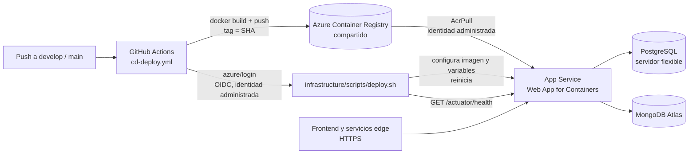

# Despliegue de la API en Microsoft Azure (CI/CD)

> **Estado: en ejecución** (TS-41, rama `cd/workflow-for-deployment`; última revisión 2026-11-06). Los pasos 1 y 2 del
> §13 están hechos, el 3 está aplicado en Azure a falta de su cierre y el 4 y el 5 están implementados pero sin ejecutar
> contra Azure ni GitHub (ver *Avance*): el Terraform, el Dockerfile, `deploy.sh` y `cd-deploy.yml` existen y `shared` y
> `staging` están creados. La identidad de despliegue (D-6 revisada) está definida en Terraform pero sin aplicar, los
> entornos de GitHub no están configurados y `production` no se ha aplicado. Cada afirmación lleva una marca:
> **[Confirmado]** respaldado por el repositorio o por una decisión del equipo, **[Derivado]** deducido de lo anterior,
> **[Pendiente]** requiere verificarse en la cuenta de Azure antes de implementarlo.

## 1. Propósito y alcance

Preparar la entrega continua (CD) y el despliegue continuo del monolito modular de la API de Alivia: la imagen se
construye con Docker, se publica en Azure Container Registry (ACR) y se ejecuta como aplicación web en Azure App Service.
La infraestructura se define con Terraform y el despliegue lo hace un script invocado desde GitHub Actions.

| Subtarea | Resumen en Jira | Dónde se resuelve en este documento |
|---|---|---|
| **AP-468** | DevOps - Preparar infraestructura en Microsoft Azure | §4 arquitectura, §5 estructura, §6 Terraform |
| **AP-465** | DevOps - Desplegar API y configurar el acceso al servicio en Azure | §7 workflow de CD, §8 script de despliegue, §4.3 acceso |
| **AP-466** | DevOps - Gestionar secretos, configuración y verificación del despliegue | §9 secretos y configuración, §10 verificación |

Fuera de alcance: la aplicación web del frontend, el broker MQTT local de los hogares, los servicios edge y cualquier
cambio funcional de la API. La historia padre (TS-41, AP-99) no trae criterios de aceptación en Jira `[Confirmado]`; los
criterios de finalización de §13 son una propuesta para validar con quien la asignó.

## 2. Punto de partida

| Elemento | Estado | Evidencia |
|---|---|---|
| `Dockerfile` multi-etapa (Maven + Temurin 25, JRE final) | **[Confirmado]** existe; construye con `mvn clean package -DskipTests`, expone 8080 | `Dockerfile` |
| `.dockerignore` | **[Confirmado]** no existe: el contexto de build incluye `target/`, `.git`, `backups/`, `opencode/`, `graphify-out/` | raíz del repositorio |
| Usuario del contenedor | **[Confirmado]** `root` (no hay `USER`) | `Dockerfile` |
| CI en pull requests (`build`, `tests`, `sonarcloud`) con JDK 25 | **[Confirmado]** | `.github/workflows/web-service-ci.yml` |
| Perfil `prod`: `ddl-auto=validate`, Flyway activo, Swagger apagado | **[Confirmado]** | `application-prod.properties` |
| `server.port=${PORT}` sin valor por defecto en `prod` | **[Confirmado]** la aplicación **no arranca** si `PORT` no está definida | `application-prod.properties` |
| Sonda de salud pública `/actuator/health` (y `/actuator/info`) | **[Confirmado]**; con `show-details=when_authorized` solo informa `UP`/`DOWN` | `WebSecurityConfiguration`, `application.properties` |
| Esquema creado solo por Flyway (`V1`..`V18`), verificado contra PostgreSQL 17 y 18 | **[Confirmado]** | `docs/database-migrations.md` |
| Detrás de un proxy hay que fijar `server.forward-headers-strategy`, o el límite de intentos de las credenciales de los edge cuenta a todos los clientes como uno | **[Confirmado]** | `application.properties`, `EdgeFailedAttemptsLimiter` |
| Documentación antigua que menciona Oracle OCI como nube de despliegue | **[Confirmado]** contradice a TS-41/TS-42 (Azure); queda registrada como C-03 | `opencode/PROJECT_CONTEXT.md` |

Lo que el despliegue **no** necesita cambiar en el código: el perfil `prod` ya lee toda su configuración de variables de
entorno. Sí hay que definirlas todas (§9).

## 3. Decisiones

### 3.1 Tomadas por el equipo

| # | Decisión | Consecuencia |
|---|---|---|
| D-1 | Despliegue con contenedores: Docker + ACR + App Service (Web App for Containers, Linux) | §4 |
| D-2 | Infraestructura con Terraform; el despliegue lo hace un script invocado desde GitHub Actions | §6, §8 |
| D-3 | Terraform gestiona **la plataforma de la API, PostgreSQL (Azure Database for PostgreSQL, servidor flexible) y MongoDB Atlas** | §6 |
| D-4 | **Sin Azure Key Vault** (cuenta universitaria con créditos): los secretos viven en **GitHub Secrets** | §9 |
| D-5 | Dos entornos: **staging** y **production** | §4, §7 |
| D-6 | **Revisada el 2026-11-06.** GitHub Actions se autentica contra Azure con **OIDC y una identidad administrada asignada por el usuario, una por entorno**, gestionada con Terraform. No hay secreto de larga vida. Sustituye a la decisión original (service principal con secreto en GitHub Secrets), que no es viable en la suscripción de la persona asignada (R-02). Una identidad administrada es una función de Azure, no un servicio facturable: no contradice D-9 | §7.3, §9 |
| D-7 | `terraform apply` es **manual** al provisionar; el CI solo valida (`fmt` y `validate`) | §6.5 |
| D-8 | **Un único Resource Group** (`rg-alivia`) para todo. Un Resource Group es solo un contenedor y **no consume créditos**: el gasto lo generan los recursos que contiene, no cuántos grupos haya | §4.2 |
| D-9 | **Solo se usan GitHub, Docker, Terraform y los servicios nombrados**: Azure Container Registry, App Service, Azure Database for PostgreSQL (servidor flexible) y MongoDB Atlas. Ningún otro servicio ni herramienta de terceros (por eso no hay Key Vault, cuenta de almacenamiento ni Log Analytics). **Única excepción: Trivy**, que es de código abierto, corre dentro del propio runner de GitHub Actions y **no necesita cuenta ni token** | todo el documento |
| D-10 | El **estado de Terraform es local**, en la máquina de quien aplica; no se usa ningún servicio para guardarlo | §6.1 |
| D-11 | **Región:** App Service, ACR y PostgreSQL en **Brazil South**; el clúster M0 de Atlas en **East US**, la región más cercana con M0 (§4.4). Se reevalúa cuando alguna funcionalidad use MongoDB | §4.4 |

### 3.2 Propuestas aprobadas el 2026-11-06

| # | Propuesta (aprobada) | Alternativa descartada |
|---|---|---|
| P-1 | Un solo ACR compartido por ambos entornos: la imagen que se probó en staging es **la misma** que se promueve a production | Un ACR por entorno (más costo; hay que copiar la imagen) |
| P-2 | La imagen se etiqueta con el SHA del commit; no se usa `latest` | — |
| P-3 | La imagen se construye y se publica en el runner de GitHub (`docker build` + `push`), no con ACR Tasks | ACR Tasks (puede no estar disponible en suscripciones gratuitas, ver R-05) |
| P-4 | El script de despliegue es el **único dueño** de la configuración de la aplicación en App Service; Terraform no define esas variables | Terraform define algunas (los secretos acabarían en el estado) |
| P-5 | `staging` se despliega al hacer push a `develop`; `production` al hacer push a `main`, con aprobación manual del entorno de GitHub | `release/**` → staging, como el repositorio de referencia |
| P-6 | La base de datos y Atlas aceptan solo las IP de salida de la aplicación (reglas por IP) | «Permitir servicios de Azure» / `0.0.0.0/0` (más simple, menos seguro) |
| P-7 | Mientras ningún código use MongoDB, desactivar su indicador en `/actuator/health` con `MANAGEMENT_HEALTH_MONGODB_ENABLED=false` | Dejarlo activo: una caída de Atlas tumbaría la verificación del despliegue (§4.4) |

## 4. Arquitectura

### 4.1 Flujo



### 4.2 Recursos por entorno

| Recurso | Staging | Production | Notas |
|---|---|---|---|
| Resource Group | `rg-alivia` | `rg-alivia` (el mismo) | Único (D-8). Los recursos se distinguen por el sufijo de entorno en el nombre y por la etiqueta `environment` |
| Container Registry | compartido (`acralivia<sufijo>`) | compartido | SKU Basic, sin usuario administrador. Repositorio `alivia-api` |
| App Service Plan (Linux) | B1 | B1 (S1 si se necesitan *slots*) | **[Pendiente]** R-04: el plan gratuito (F1) no admite contenedores propios |
| Web App for Containers | `app-alivia-<entorno>-<sufijo>` | ídem | Imagen del ACR; identidad administrada con rol `AcrPull`. El sufijo (5 caracteres aleatorios y estables) hace único el nombre, que es global en Azure |
| PostgreSQL servidor flexible | Burstable `B1ms`, 32 GB | Burstable `B1ms` o `B2s` | `Standard_B1ms` figura en Brazil South **[Confirmado por la persona asignada, 2026-11-06]**; la versión a elegir sigue en R-03 |
| MongoDB Atlas | Proyecto y clúster M0 (gratuito) en **East US** | Proyecto y clúster M0 en East US, o de pago si hay presupuesto | M0: sin copias de seguridad ni red privada, 512 MB. East US es la región de Azure más cercana con M0 (D-11) |
| Registros | Los de App Service (sistema de archivos, 7 días) | ídem | Se leen con *Log stream* o `az webapp log tail`; no hay servicio de registros aparte (D-9) |

### 4.3 Acceso al servicio (AP-465)

- **URL:** `https://app-alivia-<entorno>.azurewebsites.net` con certificado administrado de Azure. Un dominio propio es
  opcional y queda **[Pendiente]** (se decide cuando exista el dominio).
- **Solo HTTPS**, TLS 1.2 como mínimo, FTP deshabilitado, afinidad de sesión (ARR) desactivada: la API no guarda estado de
  sesión en el servidor.
- **Puerto:** el contenedor escucha en 8080. Se definen `PORT=8080` (la exige el perfil `prod`) y `WEBSITES_PORT=8080`
  (Azure la usa para saber a qué puerto enviar el tráfico).
- **Proxy:** Azure termina TLS delante del contenedor, así que se define `SERVER_FORWARD_HEADERS_STRATEGY=framework`;
  sin ella, el límite de credenciales fallidas de los edge cuenta a todos como una sola dirección.
- **Espera larga de los edge:** `GET /api/v1/edge/device-table?wait=25` mantiene la petición hasta 25 s. El tiempo de
  inactividad del balanceador de App Service es de unos 230 s **[Derivado]**, muy por encima, así que no hay conflicto.
- **CORS:** `CORS_ALLOWED_ORIGINS` con el origen del frontend de cada entorno.

### 4.4 Región

**Regla:** App Service, PostgreSQL y el ACR van en la **misma región** (menos latencia y sin tráfico entre regiones). Atlas
va en la misma región de Azure si su nivel gratuito la ofrece. Los usuarios (el frontend y los hogares con los servicios
edge) están en Perú **[Derivado]**: el proyecto usa la zona horaria `America/Lima`.

**Orden de preferencia «en teoría»** (más cerca de Perú primero; son suposiciones geográficas, no mediciones):

| # | Región                          | Por qué                                                                                                                                  | Qué falta comprobar                                                                                                     |
|---|---------------------------------|------------------------------------------------------------------------------------------------------------------------------------------|-------------------------------------------------------------------------------------------------------------------------|
| 1 | **Brazil South** (São Paulo)    | La región de Azure con catálogo completo más cercana a Perú                                                                              | Que la directiva de la cuenta la permita; que haya `B1` Linux y `Standard_B1ms` de PostgreSQL con capacidad             |
| 2 | Chile Central o Mexico Central  | Más cerca, pero son regiones recientes                                                                                                   | **Sin evidencia** de que ofrezcan App Service Linux B1 ni PostgreSQL Burstable: se comprueba como en el punto siguiente |
| 3 | East US 2, East US o Central US | Lejos de Perú, pero son las de mayor disponibilidad de SKU, y suelen ser las que dejan abiertas las cuentas de estudiante **[Derivado]** | Las mismas comprobaciones                                                                                               |

**Lo que realmente decide la región en una cuenta de estudiante:** Azure for Students aplica la directiva *Allowed resource
deployment regions*, que permite solo unas tres a cinco regiones y **cambia de una cuenta a otra**; no existe una lista
pública. La región se elige, por tanto, entre las que la cuenta permite. Procedimiento (se ejecuta una vez, antes del paso 2
de §13):

1. Leer las regiones permitidas de la propia suscripción: `az policy assignment list --query "[].{nombre:displayName, parametros:parameters}" -o json`
   y buscar la asignación *Allowed resource deployment regions*.
2. Para cada región candidata, comprobar App Service: `az appservice list-locations --sku B1 --linux-workers-enabled`.
3. Comprobar PostgreSQL: `az postgres flexible-server list-skus -l <región>`; debe aparecer `Standard_B1ms` (Burstable) y la
   versión elegida (mínimo 17).
4. Comprobar MongoDB Atlas: al crear un clúster gratuito en Atlas con proveedor Azure, la interfaz muestra solo las regiones
   donde existe el nivel M0 **[Pendiente]**: no encontré una lista oficial y vigente.
5. Elegir, de las que pasan 2, 3 y 4, **la más alta de la tabla anterior**.
6. Probar con un recurso real: aun listada, una región puede fallar por falta de capacidad (`CapacityNotAvailable`); si ocurre,
   se usa la siguiente.

#### Resultado de la verificación (2026-11-06) y decisión D-11

La persona asignada ejecutó el procedimiento en su suscripción: **Brazil South** y `Standard_B1ms` figuran como disponibles,
y el clúster gratuito M0 de Atlas en Azure solo se ofrece, de las regiones cercanas, en **East US**.

| Qué | Dónde | Motivo |
|---|---|---|
| App Service, ACR y PostgreSQL | **Brazil South** (`location = "brazilsouth"`) | Es lo que usa la API en cada petición; la más cercana a Perú |
| MongoDB Atlas M0 | **East US** (nombre de Atlas: `US_EAST`, aceptado por Atlas al crear el clúster de `staging`, 2026-11-06) | Es la única región cercana con M0 |

**Por qué esta separación no tiene costo hoy:** el código de producción **no usa MongoDB**. No hay documentos ni
repositorios Mongo: solo existe la clase base abstracta `AuditableMongoAggregateRoot`, que únicamente usa una prueba. Lo
único que cruza de Brazil South a East US es el sondeo de salud y la conexión inicial. La separación sí costaría (del orden
de cien milisegundos por consulta **[Derivado, sin medir]**) en cuanto una funcionalidad lea o escriba en MongoDB: entonces
se reevalúa subiendo a un clúster de pago en Brazil South, que Atlas ofrece en todas las regiones (R-12).

**Descartado:** poner todo en East US. PostgreSQL sí está en el camino de cada petición, y mover la API y la base de datos
lejos de los usuarios para acomodar una base que hoy nadie consulta empeora la latencia de todo el servicio.

**Acoplamiento y decisión P-7 (confirmada el 2026-11-06):** Spring Boot incluye a MongoDB en `/actuator/health`. Si Atlas no
responde (por ejemplo, por un cambio de las IP de salida, R-06), la salud sería `DOWN` aunque la API no use MongoDB, y tanto la
verificación del despliegue como la comprobación de salud de App Service lo tratarían como una falla. Por eso `deploy.sh`
fija `MANAGEMENT_HEALTH_MONGODB_ENABLED=false` en ambos entornos mientras nada use MongoDB. Consecuencias:

- Una caída de Atlas **no** tumba un despliegue ni marca la instancia como no saludable.
- La verificación de salud **ya no prueba** que la API alcance Atlas. La conexión con Atlas se comprueba una vez al
  provisionar (paso 3 de §13, con la cadena de conexión de `terraform output`), no en cada despliegue.
- **El nombre importa y se comprobó con la imagen real:** en Spring Boot 4.1 la propiedad es `management.health.mongodb.enabled`
  (con «db»). Con el nombre de versiones anteriores (`...mongo...`) no tiene efecto: con MongoDB detenido, `/actuator/health`
  tardó 30 s (el tiempo de selección de servidor del controlador) y respondió `DOWN`. Con el nombre correcto responde `UP`
  al instante.
- **Condición para revertirlo:** la primera funcionalidad que lea o escriba en MongoDB debe quitar esta variable (y
  reevaluar la región, D-11) en el mismo cambio que la introduce. Queda como criterio de revisión de esa funcionalidad.

Para medir la latencia real desde Perú, una vez desplegado `staging`, basta cronometrar `GET /actuator/health` desde Lima; no
hay cifras publicadas de Microsoft para Lima.

## 5. Estructura propuesta del repositorio

Sigue la organización del repositorio de referencia (`modules/`, `environments/`, `scripts/`); no incluye su `bootstrap/`, que
crea el estado remoto (D-10).

```
infrastructure/
  terraform/
    README.md
    modules/
      registry/                # ACR
      platform/                # plan, Web App, identidad administrada, registros de App Service
      postgres/                # servidor flexible, base de datos, reglas de firewall
      mongodb-atlas/           # proyecto, clúster, usuario, lista de acceso
      deploy-identity/         # identidad de despliegue (OIDC), su credencial federada y sus dos roles
    environments/
      shared/                  # rg-alivia (el único Resource Group) + ACR
      staging/                 # plataforma + datos de staging
      production/              # plataforma + datos de production
  scripts/
    deploy.sh                  # despliegue y verificación (lo invoca el workflow)
    tests/deploy_test.sh       # pruebas de deploy.sh con az y curl simulados
.github/workflows/
  cd-deploy.yml                # construir, publicar y desplegar
  terraform-validate.yml       # fmt y validate en cada PR que toque infrastructure/terraform
.dockerignore                  # nuevo
```

Los `*.tfvars`, `*.tfstate` y `.terraform/` entran en `.gitignore`; se versionan solo los `*.tfvars.example` y
`.terraform.lock.hcl`.

## 6. Infraestructura con Terraform (AP-468)

### 6.1 Estado local (D-10)

- Cada raíz (`shared`, `staging`, `production`) guarda su `terraform.tfstate` en su propia carpeta, en la máquina de quien
  aplica. **Nunca se versiona**: contiene las contraseñas de PostgreSQL y de Atlas, generadas con `random_password`.
- No hay bloqueo: **solo una persona aplica a la vez**, y nadie más debería ejecutar `apply` sin tener el estado actualizado.
- **El archivo es el único registro** de lo que Terraform creó. Si se pierde, Terraform ya no conoce los recursos: habría que
  importarlos uno a uno o borrarlos a mano. Por eso, después de cada `apply`, se copia el `terraform.tfstate` a un lugar
  protegido **fuera del repositorio** (por ejemplo, un disco cifrado propio). Eso no usa ningún servicio nuevo, pero es
  responsabilidad de quien aplica (R-10).
- Si más adelante el equipo crece, el estado se mueve a un backend remoto con `terraform init -migrate-state`; hoy no se
  adopta por D-9.

### 6.2 Módulos

| Módulo | Crea | Salidas |
|---|---|---|
| `registry` | Container Registry Basic, administración deshabilitada | `login_server`, `id` |
| `platform` | App Service Plan Linux, Web App con identidad administrada y rol `AcrPull` sobre el ACR, `https_only`, `ftps_state = Disabled`, `health_check_path = /actuator/health`, `always_on`, registros de aplicación y HTTP en el sistema de archivos de App Service | `webapp_name`, `default_hostname`, `outbound_ips` |
| `postgres` | Servidor flexible, base de datos, `require_secure_transport = on`, una regla de firewall por IP de salida de la Web App, contraseña con `random_password` | `fqdn`, `database`, `admin_user`, `admin_password` (sensible) |
| `mongodb-atlas` | Proyecto, clúster (M0 o M10), usuario de base de datos con contraseña aleatoria, lista de acceso con las IP de salida de la Web App | `connection_string_srv` (sensible), `database` |
| `deploy-identity` | Identidad administrada `id-alivia-<entorno>-deploy`, una credencial federada para el entorno de GitHub del mismo nombre y dos roles: `AcrPush` sobre el ACR y `Website Contributor` sobre la Web App de ese entorno | `client_id`, `subject`, `role_assignments` |

Los dos entornos usan los mismos módulos y difieren solo en tamaño y redundancia (variables de cada `environments/*`).
Los recursos llevan las etiquetas `project=alivia`, `environment`, `ticket=TS-41` y `managed_by=terraform`. Con un solo
Resource Group (D-8), la raíz `shared` crea `rg-alivia` y `staging`/`production` lo leen con un `data` de Terraform: así
`terraform destroy` de un entorno no puede borrar el grupo ni el otro entorno.

### 6.3 Redes y acceso a las bases de datos

- Se usa acceso público con reglas por IP (P-6). Las IP de salida de la Web App salen de
  `possible_outbound_ip_addresses`; **pueden cambiar** si se cambia el SKU del plan, y entonces hay que volver a aplicar
  Terraform para actualizar PostgreSQL y Atlas. Es la causa más probable de «la API no conecta tras un cambio de plan».
- **Cuántas reglas salen:** el módulo `platform` expone `possible_outbound_ip_address_list`, no solo las direcciones
  que la Web App usa ahora. En `staging` son **31 reglas** de PostgreSQL (y otras tantas entradas en Atlas), frente a 13
  direcciones actuales **[Confirmado]**. Es deliberado: Azure puede mover la aplicación a otra unidad de escala (por
  ejemplo al cambiar de SKU) y entonces usaría una de las 18 restantes; con solo las 13 actuales la API perdería el acceso
  a las bases sin aviso (R-06). El costo es una superficie algo mayor, siempre dentro de direcciones de Azure y no
  `0.0.0.0/0`. Usar `outbound_ip_address_list` (solo las actuales) es un cambio de una línea, a cambio de volver a
  aplicar Terraform cada vez que Azure cambie las IP. No se verificaron los límites de reglas de PostgreSQL ni de la
  lista de acceso de Atlas; 31 queda muy por debajo de los que se conocen.
- JDBC con SSL: `jdbc:postgresql://<fqdn>:5432/<base>?sslmode=require`.
- Una red virtual con endpoint privado sería lo ideal para production; no se plantea ahora por costo y por las
  restricciones de la cuenta (R-03). Atlas M0 no admite red privada de todos modos.

### 6.4 Proveedores y credenciales de quien aplica

- `azurerm` y `random` (HashiCorp) y `mongodb/mongodbatlas`; las versiones se fijan al implementar. No se usa ningún otro
  proveedor.
- Quien aplica usa `az login` con su cuenta; para Atlas, `MONGODB_ATLAS_PUBLIC_KEY` y `MONGODB_ATLAS_PRIVATE_KEY`
  (clave de organización) y el identificador de la organización, como variables de entorno locales. **El CI no necesita
  ninguna** porque solo valida.

### 6.5 Cómo se aplica (manual)

Los comandos y los requisitos previos están en `infrastructure/terraform/README.md`. El orden es `shared` → `staging` →
`production`, y cada raíz guarda su estado local (§6.1).

**La primera vez de cada entorno son dos pasos.** PostgreSQL y Atlas solo aceptan las IP de salida de la Web App, y Azure las
informa cuando la Web App ya existe. Un `plan` de todo a la vez falla con *Invalid for_each argument* (se reprodujo con
proveedores simulados; el propio mensaje de Terraform sugiere esta salida):

```bash
terraform apply -target=module.platform   # crea la Web App y sus IP de salida
terraform plan -out tfplan && terraform apply tfplan
```

Es la única vez que se usa `-target`. Después, cada cambio es un `plan` y un `apply` normales; si las IP de salida cambian
(R-06), un `apply` normal actualiza las reglas de las dos bases de datos.

**Valores de ejemplo y `operator_ips`.** Todo `terraform.tfvars` se copia de su `.example`, que trae marcadores
(`acralivia00000`, `000000000000000000000000`, `203.0.113.10`). Hay que sustituirlos: el primero por la salida `acr_name`
de `shared`, el segundo por el identificador de la organización de Atlas y el tercero, solo mientras se prueba la conexión,
por **la propia IPv4 pública** de quien prueba. Con un marcador sin cambiar, Terraform falla (`Registry Name ... was not
found`) o, peor, crea una regla de firewall para una dirección que no es la de quien prueba y la conexión se rechaza.
Después de la prueba se borra `operator_ips` y se vuelve a aplicar, de modo que la IP desaparezca de PostgreSQL y de Atlas.

`terraform-validate.yml` ejecuta `terraform fmt -check`, `init -lockfile=readonly`, `validate` y, en `staging` y
`production`, `terraform test` (proveedores simulados: comprueba el flujo de dos pasos y las salidas, no Azure) en cada pull
request que toque `infrastructure/terraform/`, con `hashicorp/setup-terraform`. No tiene credenciales de Azure ni de Atlas
ni estado.

## 7. Pipeline de CD (AP-465)

### 7.1 Disparadores

| Evento | Entorno | Imagen |
|---|---|---|
| Push a `develop` (cambios en `src/**`, `pom.xml`, `Dockerfile`, `infrastructure/scripts/**` o el propio workflow) | `staging` | Se construye con el SHA del commit |
| Push a `main` (mismos filtros) | `production` | Se construye con el SHA del commit; **requiere aprobación** del entorno `production` |
| `workflow_dispatch` con `environment` y `image_tag` opcional | el elegido | Si se da `image_tag` se **reutiliza** esa imagen del ACR (promover a production lo que se probó en staging) |

El CD **no repite las pruebas**: ya corren en el pull request. Para que eso sea cierto, la protección de ramas de
`develop` y `main` debe exigir que `Check - Maven Test Suite` pase **[Pendiente]** (R-08).

### 7.2 Trabajos

**Dos trabajos, no tres.** El diseño original separaba `build` y `deploy`. Con D-6 revisada (§7.3), Azure solo acepta el
inicio de sesión de un trabajo que corra **dentro del entorno de GitHub** de la identidad, y publicar en el ACR exige ese
inicio de sesión. Un trabajo `build` separado tendría que correr también en el entorno, y en `production` pediría la
aprobación **dos veces**. Por eso construir, analizar, publicar y desplegar ocurren en un mismo trabajo.

1. **resolve** (sin entorno): decide entorno y etiqueta, valida que la etiqueta sea una etiqueta de commit (no `latest`) y
   que `production` solo se despliegue desde `main`, y escribe el plan en el resumen de la ejecución.
2. **deploy** (dentro del entorno `staging` o `production`; `concurrency` por entorno, sin cancelar uno en curso; 45 min de
   límite):
   1. Comprueba que el entorno tenga sus variables de Azure y lista los **nombres** que falten.
   2. Solo si no se dio `image_tag`: construye la imagen en el runner (`docker/build-push-action`, cargada en el Docker local,
      **sin publicar**), la **analiza con Trivy** y, solo si el análisis pasa, la publica en el ACR con la etiqueta `<sha>`
      completa del commit. El análisis falla ante vulnerabilidades CRITICAL o HIGH **que tengan corrección disponible**
      (`severity: CRITICAL,HIGH`, `ignore-unfixed: true`, `exit-code: 1`, `scanners: vuln`); las que aún no tienen
      corrección no bloquean. Trivy descarga su base de vulnerabilidades de un registro público: no hay cuenta, pero sí un
      posible límite de descargas (R-13).
   3. Inicia sesión en Azure con OIDC (`azure/login`) y, para publicar, `az acr login`.
   4. Ejecuta `infrastructure/scripts/deploy.sh <entorno> <etiqueta>` con las variables y los secretos del entorno (§9.1).

**Acciones, fijadas por SHA de commit** (el comentario de cada una lleva la versión): `actions/checkout` v7.0.1,
`docker/setup-buildx-action` v4.4.1, `docker/build-push-action` v7.4.0, `azure/login` v3.1.0 y
`aquasecurity/trivy-action` v0.36.0. Todas son de Node 24. Se fijan por SHA y no por etiqueta porque este trabajo tiene un
token de Azure y publica imágenes, y `trivy-action` fue **comprometida en marzo de 2026 a través de sus etiquetas**; no se
usan sus etiquetas anteriores a la `v0.35.0` ni las que carecen de `v`. Para actualizar una, se busca el release nuevo, se
leen sus notas y se cambian el SHA y la versión. Se descartó `docker/login-action`: con OIDC no hay usuario ni contraseña,
y `az acr login` usa el token de la identidad. **No verificado:** que `az acr login` funcione con esta identidad en un
ejecutor de GitHub.

### 7.3 Autenticación contra Azure (D-6)

**OIDC con una identidad administrada por entorno** (módulo `deploy-identity`, aplicado con Terraform en `staging` y en
`production`). GitHub demuestra quién es el trabajo con un token de corta vida y Azure confía en él solo para un sujeto
concreto, así que no hay secreto que guardar ni rotar.

| Identidad | Roles | Quién puede iniciar sesión (sujeto de la credencial federada) |
|---|---|---|
| `id-alivia-staging-deploy` | `AcrPush` sobre el ACR; `Website Contributor` sobre la Web App de staging | `repo:resolum/alivia-web-services:environment:staging` |
| `id-alivia-production-deploy` | `AcrPush` sobre el ACR; `Website Contributor` sobre la Web App de production | `repo:resolum/alivia-web-services:environment:production` |

- **Una identidad por entorno, no una compartida.** Con una sola identidad con roles sobre las dos Web Apps, un trabajo de
  `staging` podría iniciar sesión con ella y desplegar en `production`, saltándose la aprobación de ese entorno. Con una por
  entorno, la identidad de staging no tiene ningún permiso sobre la Web App de production, y `terraform test` lo comprueba
  (exactamente dos roles, cada uno sobre su recurso y ninguno sobre el grupo de recursos).
- **El nombre del entorno de GitHub debe coincidir exactamente** (`staging`, `production`): forma parte del sujeto. Un
  trabajo que no corra en ese entorno, o que corra en un pull request, es rechazado por Azure.
- **El workflow** necesita `permissions: id-token: write` y usa `azure/login` con `client-id`, `tenant-id` y
  `subscription-id`. Los tres son identificadores y van como **variables** del entorno de GitHub, no como secretos; salen de
  `terraform output` (§9.2). Ya no existe `AZURE_CLIENT_SECRET`.
- **Repositorio:** la variable `github_repository` de Terraform vale `resolum/alivia-web-services` por defecto. Si el
  repositorio cambia de dueño o de nombre, hay que cambiarla y volver a aplicar, porque Azure compara el sujeto
  literalmente.
- **[Pendiente]** El `apply` real de la identidad y de su credencial federada, el inicio de sesión desde GitHub y los
  permisos efectivos de estos dos roles sobre `az acr repository show` y `az webapp config set` no están verificados: se
  comprueban con el primer `apply` y con el primer despliegue desde el workflow (paso 5).

## 8. Script de despliegue (AP-465 y AP-466)

`infrastructure/scripts/deploy.sh <staging|production> <etiqueta>`; Bash con `set -euo pipefail`. El workflow ya inició
sesión con `az`; el script **no** maneja credenciales de Azure.

| Paso | Qué hace | Falla si |
|---|---|---|
| 1 | Valida argumentos y que estén definidas las variables obligatorias (§9). Enmascara los valores secretos | falta alguna: lista **los nombres**, nunca los valores |
| 2 | Comprueba que la imagen `alivia-api:<etiqueta>` exista en el ACR | no existe |
| 3 | Guarda la imagen que corre ahora (para el rollback) | — |
| 4 | Aplica la configuración con `az webapp config appsettings set` desde un archivo temporal con permisos `0600` que se borra al terminar (no se pasa en la línea de comandos) | `az` falla |
| 5 | `az webapp config set --linux-fx-version "DOCKER\|<imagen>"` con la imagen nueva y reinicia. Cambia solo la imagen y no toca la configuración de credenciales del registro (la Web App usa su identidad administrada); `config container set` no se probó **[Pendiente]** | `az` falla |
| 6 | Espera hasta 10 min a que `GET /actuator/health` responda `UP` (exige que PostgreSQL responda; MongoDB queda fuera por P-7; ver §10) | no llega a `UP` |
| 7 | Comprueba que la Web App ejecuta la imagen pedida, `GET /actuator/info` y una ruta pública que usa la base de datos (`GET /api/v1/plans`), ambas con 200, y que `GET /v3/api-docs` y `GET /api/v1/devices` sin credencial **no** respondan 2xx (§10) | respuesta distinta de 200, o 2xx en una ruta que debe estar cerrada |
| 8 | Imprime `Desplegado <etiqueta> en <entorno>: <URL>` | — |

Detalles de la implementación: la configuración se escribe en un archivo JSON temporal (no hay `jq` garantizado; el
escapado se prueba con contraseñas con comillas, barras y tabuladores) y `az` se invoca con `-o none`, porque por defecto
imprimiría todos los valores de la aplicación. Tras el reinicio espera `DEPLOY_WARMUP_SECONDS` (30 por defecto), porque el
contenedor antiguo sigue respondiendo unos segundos y la primera comprobación podría ser suya. Se niega a desplegar si
`AZURE_WEBAPP_NAME` no empieza por `app-alivia-<entorno>-` (evita aplicar la configuración de un entorno a la Web App del
otro), si la etiqueta es `latest`, si `IAM_JWT_SECRET` tiene menos de 32 bytes o si el super administrador conserva los
marcadores `EMAIL`/`PASSWORD`. Sus pruebas están en `infrastructure/scripts/tests/deploy_test.sh`, con `az` y `curl`
simulados: **no demuestran** que el `az` real acepte esos argumentos ni que los roles de la identidad alcancen.

**Rollback automático:** si falla el paso 6 o 7, el script restaura la imagen guardada en el paso 3, reinicia y sale con
código 1. Si la imagen anterior no está en el registro (primer despliegue: la Web App nace con `alivia-api:initial`, que no
existe), avisa de que no hay nada que restaurar y sale igualmente con 1. La configuración de la aplicación **no** se restaura:
solo la imagen. Importante: las migraciones de Flyway se aplican **al arrancar** y no se deshacen. Volver a una imagen anterior
solo es seguro si las migraciones nuevas son compatibles hacia atrás; ver §11.2.

## 9. Secretos y configuración (AP-466)

### 9.1 Dónde vive cada cosa

| Tipo | Dónde | Ejemplos |
|---|---|---|
| Inicio de sesión en Azure (OIDC, D-6) | GitHub Variables **del entorno**: son identificadores, no secretos | `AZURE_CLIENT_ID`, `AZURE_TENANT_ID`, `AZURE_SUBSCRIPTION_ID`. No hay `AZURE_CLIENT_SECRET` |
| Secretos de la aplicación | GitHub Secrets **del entorno** (`staging`, `production`) | `IAM_JWT_SECRET`, `STRIPE_*`, `CLOUDINARY_API_*`, `DB_PASSWORD`, `MONGODB_URI`, `IAM_SUPER_ADMIN_PASSWORD`, `RESEND_API_KEY` |
| Configuración no secreta | GitHub Variables **del entorno** | `CORS_ALLOWED_ORIGINS`, `IAM_EMAIL_VERIFICATION_LINK_BASE_URL`, `DB_URL`, `DB_USERNAME`, `MONGODB_DATABASE` |
| Nombres de los recursos | GitHub Variables **del entorno** | `AZURE_RESOURCE_GROUP`, `AZURE_WEBAPP_NAME`, `ACR_NAME` (los nombres llevan un sufijo aleatorio, así que `deploy.sh` no puede deducirlos: los recibe) |
| Valores fijos del despliegue | El propio `deploy.sh` | `SPRING_PROFILES_ACTIVE=prod`, `PORT`, `WEBSITES_PORT`, `SERVER_FORWARD_HEADERS_STRATEGY`, `MANAGEMENT_HEALTH_MONGODB_ENABLED=false` (P-7) |

**Cómo los conecta `cd-deploy.yml`** (todos son del **entorno** de GitHub, no del repositorio; un valor vacío cuenta como no
definido):

| Origen | Variables |
|---|---|
| `secrets.*` | `DB_PASSWORD`, `MONGODB_URI`, `IAM_JWT_SECRET`, `STRIPE_SECRET_KEY`, `STRIPE_WEBHOOK_SECRET`, `CLOUDINARY_API_KEY`, `CLOUDINARY_API_SECRET`, `IAM_SUPER_ADMIN_PASSWORD`, `RESEND_API_KEY` (opcional) |
| `vars.*` obligatorias | `AZURE_CLIENT_ID`, `AZURE_TENANT_ID`, `AZURE_SUBSCRIPTION_ID`, `AZURE_RESOURCE_GROUP`, `AZURE_WEBAPP_NAME`, `ACR_NAME`, `DB_URL`, `DB_USERNAME`, `MONGODB_DATABASE`, `CORS_ALLOWED_ORIGINS`, `IAM_EMAIL_VERIFICATION_LINK_BASE_URL`, `STRIPE_PUBLISHABLE_KEY`, `CLOUDINARY_CLOUD_NAME`, `IAM_SUPER_ADMIN_EMAIL` |
| `vars.*` opcionales | las 17 restantes de `OPTIONAL_APP_VARS` de `deploy.sh` (la 18.ª es `RESEND_API_KEY`, un secreto) (`IAM_EMAIL_PROVIDER`, `IAM_ACCOUNT_ACTIVATION_LINK_BASE_URL`, `JAVA_TOOL_OPTIONS`, ...) |

Se comprobó con un script que las 37 variables que `deploy.sh` espera están conectadas en el workflow, que no sobra
ninguna y que todo valor que `deploy.sh` trata como secreto viene de `secrets.*`.

El script los recibe como variables de entorno del paso del workflow y los copia a la configuración de App Service
(P-4). App Service cifra esa configuración en reposo y la entrega al contenedor como variables de entorno. Los secretos
de GitHub se enmascaran en los registros; el script además no imprime valores.

### 9.2 De Terraform a GitHub

Terraform genera las credenciales de las bases de datos, y la aplicación las necesita como secretos. El paso es manual y
se hace una vez por entorno (y al rotar):

```bash
# secretos del entorno (nunca se imprimen con un `terraform output` sin -raw y nombre)
terraform output -raw postgres_administrator_password   # -> DB_PASSWORD
terraform output -raw mongodb_connection_string         # -> MONGODB_URI

# variables del entorno
terraform output -raw postgres_jdbc_url                 # -> DB_URL (ya trae sslmode=require)
terraform output -raw postgres_administrator_login      # -> DB_USERNAME
terraform output -raw mongodb_database                  # -> MONGODB_DATABASE
terraform output -raw resource_group_name               # -> AZURE_RESOURCE_GROUP
terraform output -raw webapp_name                       # -> AZURE_WEBAPP_NAME
terraform output -raw acr_name                          # -> ACR_NAME
terraform output -raw deploy_identity_client_id         # -> AZURE_CLIENT_ID (la identidad de ESTE entorno)
terraform output -raw azure_tenant_id                   # -> AZURE_TENANT_ID
terraform output -raw azure_subscription_id             # -> AZURE_SUBSCRIPTION_ID
terraform output -raw default_hostname                  # -> la URL de la API es https://<este valor>
```

Se cargan con `gh secret set ... --env <entorno>` o desde la interfaz de GitHub. El secreto nunca se guarda en el
repositorio ni en un archivo versionado.

### 9.3 Inventario de variables de la aplicación

Obligatorias (no tienen valor por defecto en `prod`) **[Confirmado]**:

| Variable | Tipo | Observación |
|---|---|---|
| `PORT` | fija | `8080` |
| `DB_URL`, `DB_USERNAME` | variable | JDBC con `sslmode=require` |
| `DB_PASSWORD` | secreto | de Terraform |
| `MONGODB_URI` | secreto | cadena `mongodb+srv://…` de Atlas |
| `MONGODB_DATABASE` | variable | nombre de la base en Atlas |
| `IAM_JWT_SECRET` | secreto | al menos 32 bytes |
| `CORS_ALLOWED_ORIGINS` | variable | origen(es) del frontend |
| `IAM_EMAIL_VERIFICATION_LINK_BASE_URL` | variable | URL del frontend para verificar correo |
| `STRIPE_SECRET_KEY`, `STRIPE_WEBHOOK_SECRET` | secretos | usar claves de prueba en staging |
| `STRIPE_PUBLISHABLE_KEY` | variable | clave pública por diseño; de prueba en staging |
| `CLOUDINARY_API_KEY`, `CLOUDINARY_API_SECRET` | secretos | |
| `CLOUDINARY_CLOUD_NAME` | variable | |

Con valor por defecto, pero **que no conviene dejar así en `prod`** **[Confirmado]**:

| Variable | Por qué |
|---|---|
| `IAM_SUPER_ADMIN_EMAIL`, `IAM_SUPER_ADMIN_PASSWORD` | Los valores por defecto son `EMAIL` y `PASSWORD` (marcadores): definir siempre |
| `IAM_EMAIL_PROVIDER` | Por defecto `unavailable`: no se envía correo. Elegir `smtp` o `resend` (y `RESEND_API_KEY`) |
| `IAM_ACCOUNT_ACTIVATION_LINK_BASE_URL` | **Faltaba en este inventario.** Lo usa `AccountActivationServiceImpl` y su valor por defecto es `http://localhost:4200/activate-account`; el perfil `prod` no lo redefine. Sin definirla, los enlaces de activación de cuenta apuntan a `localhost`. `deploy.sh` la copia si está definida y avisa si no |
| `IAM_DEFAULT_PHOTO_URL` | Hay un valor por defecto; confirmar que sirve en production |
| `HCM_DEFAULT_BUSINESS_ID` | Por defecto `1`; ese negocio debe existir en la base (ver §11.3) |

Opcionales de ajuste: `IAM_JWT_ACCESS_TOKEN_EXPIRATION_MINUTES`, `IAM_JWT_REFRESH_TOKEN_EXPIRATION_DAYS`,
`IAM_EDGE_CREDENTIAL_MAX_FAILED_ATTEMPTS_PER_MINUTE`, `IAM_EDGE_CREDENTIAL_ROTATION_RECOMMENDED_AFTER`,
`MULTIPART_MAX_FILE_SIZE` y `JAVA_TOOL_OPTIONS` (por ejemplo `-XX:MaxRAMPercentage=75`).

### 9.4 Rotación y mínimos

- `IAM_JWT_SECRET`: rotarlo invalida las sesiones activas; hacerlo fuera de horario.
- Contraseñas de bases de datos: rotar con Terraform (`-replace=random_password.<recurso>`), actualizar el secreto de
  GitHub y volver a desplegar.
- Identidad de despliegue (OIDC): no tiene secreto que rotar ni vencimiento.
- La aplicación se conecta a PostgreSQL con el usuario administrador del servidor porque Flyway necesita crear y modificar
  tablas. Un usuario dedicado con permisos mínimos queda como mejora.

## 10. Verificación del despliegue (AP-466)

| Verificación | Cómo | Qué demuestra |
|---|---|---|
| Salud | `GET /actuator/health` → `{"status":"UP"}` | La aplicación arrancó, Flyway terminó y el indicador de PostgreSQL responde **[Derivado]**: el estado agregado es `UP` solo si todos los indicadores activos lo son. El de MongoDB está desactivado por P-7 |
| Información | `GET /actuator/info` → 200 | La aplicación sirve rutas públicas |
| Base de datos | `GET /api/v1/plans` → 200 | Una consulta real a PostgreSQL |
| Seguridad | `GET /v3/api-docs` → 404/401 y `GET /api/v1/devices` sin credencial → 401 | Swagger apagado y rutas protegidas |
| Versión | La etiqueta de la imagen desplegada coincide con la pedida (`az webapp config show --query linuxFxVersion`) | Se desplegó lo que se quería |

Observabilidad mínima, solo con App Service (D-9): registros de aplicación y HTTP en el sistema de archivos (se leen con
*Log stream* o `az webapp log tail`) y la comprobación de salud de App Service (`/actuator/health`) para reemplazar
instancias que no respondan. Los registros del sistema de archivos se rotan solos y no sobreviven a un reinicio completo
del plan. Alertas, paneles y retención larga quedan fuera de este alcance.

## 11. Operación

### 11.1 Primer despliegue de un entorno

0. Resolver la región (§4.4); registrar los proveedores `Microsoft.Web`, `Microsoft.ContainerRegistry`,
   `Microsoft.DBforPostgreSQL` y `Microsoft.ManagedIdentity` en la suscripción (`az provider register`); copiar cada
   `terraform.tfvars.example` a `terraform.tfvars`.
1. Aplicar `shared` y el entorno con Terraform, este último **en dos pasos** (§6.5), y **copiar el estado a un lugar
   protegido** (§6.1). El segundo paso crea también la identidad de despliegue del entorno, su credencial federada y sus
   dos roles (§7.3).
2. Leer `deploy_identity_client_id`, `azure_tenant_id` y `azure_subscription_id` de `terraform output` y cargarlos como
   variables del entorno de GitHub (§9.2). No hay ningún secreto de Azure que crear.
3. Crear los entornos `staging` y `production` en GitHub **antes de la primera ejecución del workflow**; en `production`,
   añadir revisores obligatorios y limitar las ramas de despliegue a `main`. Si el entorno no existe, GitHub lo crea solo
   en la primera ejecución y **sin revisores**: el primer despliegue a `production` saldría sin aprobación (R-16). Los
   nombres deben ser exactamente `staging` y `production`, porque forman parte del sujeto OIDC (§7.3).
4. Cargar secretos y variables del entorno (§9.2, §9.3).
5. Ejecutar `workflow_dispatch` hacia `staging`; revisar el resumen y la verificación.
6. Promover a `production` con el mismo `image_tag` y aprobar el entorno.

### 11.2 Rollback y migraciones

- Rollback de la aplicación: automático si falla la verificación; manual con `workflow_dispatch` y la etiqueta anterior.
- Las migraciones de Flyway son solo hacia adelante. Antes de un despliegue a production con migraciones nuevas: copia de
  seguridad (`docs/operations/backup-restore.md`; el servidor flexible además guarda copias automáticas con restauración a
  un punto en el tiempo) y migraciones compatibles con la versión anterior de la aplicación.
- Con una sola instancia no hay carreras de Flyway. Si se escala a varias, Flyway usa bloqueo de base de datos, pero
  conviene verificarlo antes de hacerlo.

### 11.3 Datos iniciales

La aplicación crea la cuenta del super administrador al arrancar. **[Pendiente]** R-07: el inventario necesita que exista
el negocio `HCM_DEFAULT_BUSINESS_ID` (por defecto 1) y la aplicación no lo crea sola; en las pruebas contra PostgreSQL
se inserta a mano. Decidir cómo se crea en cada entorno (script de SQL documentado o semilla de la aplicación).

### 11.4 Costos

Plan B1 y PostgreSQL B1ms por entorno, un ACR Basic compartido y Atlas M0 gratuito. El Resource Group no cuesta nada. Dos
entornos duplican App Service y PostgreSQL:
si los créditos se agotan, la primera palanca es **apagar staging** cuando no se use (`az webapp stop`,
`az postgres flexible-server stop`). Los precios exactos se consultan en la calculadora de Azure; no se estiman aquí.

## 12. Riesgos y puntos a verificar

| ID | Riesgo | Impacto | Cómo se verifica o mitiga |
|---|---|---|---|
| R-01 | Cuenta universitaria con la directiva *Allowed resource deployment regions* y límites de SKU y cuota; la lista de regiones cambia de una cuenta a otra | No se puede crear algún recurso, o la región ideal no está permitida | Procedimiento de §4.4 antes de fijar región y tamaños |
| R-02 | El inquilino de Entra ID de la universidad puede **no permitir crear el service principal** (ni registros de aplicación) | Se cae D-6 | **Materializado el 2026-11-06:** `az ad sp create-for-rbac` falló en la suscripción de la persona asignada (se registró que falló, no el texto del error). **Resuelto con D-6 revisado (2026-11-06):** una identidad administrada asignada por el usuario por entorno, con credencial federada para GitHub (OIDC) y gestionada con Terraform (módulo `deploy-identity`, §7.3). No necesita permiso de Entra para registrar aplicaciones: `az identity create` funcionó en `rg-alivia`, la persona asignada es *Owner* de la suscripción y Terraform ya creó el rol `AcrPull`. **No verificado:** el `apply` real de la identidad y de su credencial federada, y el inicio de sesión desde GitHub (paso 5). Último recurso, si OIDC fallara: credenciales de administrador del ACR y perfil de publicación de la Web App como secretos de GitHub; `deploy.sh` cambiaría bastante |
| R-03 | La versión de PostgreSQL de las pruebas es la 18; Azure puede ofrecer menos versiones en la región, o no ofrecer el nivel Burstable ahí (se han reportado regiones sin él) | Diferencia entre pruebas y producción, o servidor no creable | Elegir la versión más alta disponible (mínimo 17: las migraciones se verificaron en 17 y 18) y comprobar `list-skus` por región |
| R-04 | El nivel gratuito (F1) no admite contenedores propios **[Derivado]** | Hace falta B1 | Verificar al crear el plan |
| R-05 | ACR Tasks puede estar bloqueado en suscripciones gratuitas | `az acr build` fallaría | Por eso P-3: construir en el runner |
| R-06 | Cambio de las IP de salida de la Web App | La API pierde acceso a PostgreSQL y Atlas | Volver a aplicar Terraform tras cambiar el SKU; la verificación de salud lo detecta |
| R-07 | El negocio inicial no se crea solo (§11.3) | El registro del inventario devuelve 404 | Decidir el mecanismo antes del primer uso real |
| R-08 | El CD asume que las pruebas pasaron en el pull request | Se podría desplegar un commit sin pruebas | Proteger `develop` y `main` exigiendo `Check - Maven Test Suite` |
| R-09 | Atlas M0 no tiene copias de seguridad, ni red privada, y tiene 512 MB | Pérdida de datos en production | Usar un clúster de pago en production cuando haya presupuesto (las copias son una función de Atlas en esos niveles) |
| R-10 | El estado de Terraform es un archivo local con contraseñas y sin copia ni bloqueo | Si se pierde, Terraform no conoce los recursos; si se filtra, se exponen las bases de datos | No versionarlo (`.gitignore`), copiarlo tras cada `apply` fuera del repositorio, un solo operador; ver §6.1 |
| R-11 | Terraform manual: nada impide que `staging` y `production` se desvíen | Entornos distintos | `terraform plan` sin cambios como parte de cada revisión de infraestructura |
| R-12 | Atlas M0 no existe en la región de la API (resuelto en §4.4: Atlas queda en East US) | Cada consulta a MongoDB cruza regiones y suma latencia | Hoy ningún código usa MongoDB; volver a evaluarlo cuando una funcionalidad lo use (D-11) |
| R-13 | Trivy descarga su base de vulnerabilidades de un registro público, que puede limitar las descargas | El paso de análisis falla sin que haya un problema real | Reintentar el trabajo; la caché de la acción reduce las descargas; un `workflow_dispatch` con `image_tag` reutiliza una imagen ya analizada y no construye ni analiza |
| R-16 | Un entorno de GitHub que no existe se crea solo en la primera ejecución, **sin revisores** | El primer despliegue a `production` sale sin aprobación | Crear `production` con revisores y rama `main` antes de ejecutar nada (§11.1, paso 3). El workflow no puede comprobarlo por sí mismo |
| R-17 | Las acciones de terceros reciben un token de Azure y publican imágenes; `trivy-action` ya fue comprometida (marzo de 2026) | Ejecución de código ajeno con acceso a Azure | Fijadas por SHA de commit (§7.2); revisar las notas de cada release antes de cambiar un SHA |
| R-14 | Atlas rechaza `backupEnabled` en un clúster M0, incluso con `false` (`TENANT_ATTRIBUTE_READ_ONLY`). **Ocurrió** en el paso 3 y está corregido: el módulo no envía el atributo en M0 | `apply` fallido a medias | `terraform test` usa proveedores simulados y **no detecta reglas de la API de Atlas ni de Azure**: solo un `apply` real lo comprueba. Al crear `production` hay que esperar los mismos tipos de fallo |
| R-15 | La Web App tiene 31 IP de salida posibles; PostgreSQL y Atlas reciben una regla por cada una (§6.3) | Ruido y más superficie de acceso de la necesaria | Decisión deliberada frente a R-06; revisable si molesta |

## 13. Plan de trabajo y criterios de finalización

Cada paso se autoriza por separado y termina con un resumen.

| Paso | Subtarea | Entregable | Se considera terminado cuando |
|---|---|---|---|
| 1 | — | Este documento revisado y aprobado | La persona asignada lo aprueba o pide cambios |
| 2 | AP-468 | Verificación de región (§4.4), `.dockerignore`, ajustes al `Dockerfile` (usuario no root, etiquetas), `infrastructure/terraform/` (módulos y entornos) y `terraform-validate.yml` | `terraform fmt -check` y `validate` pasan en CI; el contenedor se construye y arranca localmente con `docker run` (contra PostgreSQL y MongoDB de `compose.yaml`) y las variables de §9, y `/actuator/health` responde `UP` |
| 3 | AP-468 | Aplicación manual de `shared` y `staging`, con copia del estado | Los recursos existen, `terraform plan` no propone cambios y se comprobó una vez la conexión a PostgreSQL y a Atlas con las cadenas de `terraform output` (con la IP de quien prueba permitida; Atlas ya no entra en la verificación de salud, P-7) |
| 4 | AP-466 | `infrastructure/scripts/deploy.sh` con verificación y rollback | Se ejecuta a mano contra `staging` y llega a `UP`; un fallo provocado restaura la imagen anterior |
| 5 | AP-465 | `.github/workflows/cd-deploy.yml` | Un push a `develop` despliega en staging y publica el resumen con la URL |
| 6 | AP-466 | Secretos y variables cargados por entorno; runbook del primer despliegue (§11.1) | Staging y production se despliegan siguiendo solo el runbook |
| 7 | AP-465 | Promoción a production con aprobación | `workflow_dispatch` con `image_tag` de staging despliega la misma imagen en production |

### Avance

**Paso 2 ejecutado el 2026-11-06, sin commit.** Se generaron `.dockerignore`, el `Dockerfile` ajustado,
`infrastructure/terraform/` (módulos `registry`, `platform`, `postgres` y `mongodb-atlas`; raíces `shared`, `staging` y
`production`, con sus `terraform.tfvars.example`, archivos de bloqueo y pruebas) y `.github/workflows/terraform-validate.yml`.
Verificado: `terraform fmt`, `init -lockfile=readonly`, `validate` y `test` pasan en las tres raíces (con Terraform 1.17.1,
azurerm 5.13, mongodbatlas 2.21); la imagen se construye (contexto de 2,6 MB), corre como usuario `alivia` y no contiene
`application-dev.properties`; en modo `prod`, contra PostgreSQL 18 y MongoDB desechables, llega a `UP` en unos 12 s, aplica las
18 migraciones, responde 200 en una ruta pública, 404 en Swagger y 401 en una ruta protegida, y con MongoDB detenido y P-7
aplicada sigue en `UP`. **No verificado:** nada contra Azure ni Atlas reales (sin credenciales): los `apply`, la capacidad de
Brazil South, los nombres de región de Atlas y la ejecución del workflow en GitHub quedan para el paso 3 y siguientes.

**Paso 3 aplicado el 2026-11-06 (`shared` y `staging`), a falta de su cierre.** `shared` creó `rg-alivia` (Brazil South) y el
ACR; `staging` creó el plan B1, la Web App con su identidad y el rol `AcrPull`, el servidor flexible de PostgreSQL (versión
18, Burstable `B1ms`) y el proyecto y el clúster M0 de Atlas. La persona asignada comprobó a mano la conexión a PostgreSQL
(`psql` de la imagen `postgres:18`) y a Atlas (`mongosh`) con las cadenas de `terraform output`, y la identidad
administrada `id-alivia-deploy` se pudo crear. Antes se borró el grupo `alivia`, que la persona había creado a mano en
Canada Central con un ACR y un PostgreSQL de prueba (sin imágenes ni bases que conservar). Hallazgos del paso:

- **Proveedor `Microsoft.Web` sin registrar** al empezar: hay que registrarlo antes del primer `apply` (§11.1, paso 0).
- **Marcadores sin sustituir** en `terraform.tfvars` (§6.5): fallo `Registry Name ... was not found` y regla de firewall con
  una IP que no era la de quien probaba.
- **R-14:** defecto del módulo `mongodb-atlas` en M0, corregido (`backup_enabled = local.free ? null : true`).
- **R-15:** 31 reglas de firewall por IP de salida posibles (§6.3).
- **R-02:** la prueba del service principal falló; la identidad administrada con OIDC la sustituye (D-6 revisado, ver más abajo).

**Confirmado por la persona asignada (2026-11-06):** `terraform plan` en `staging` da *No changes*. **Pendiente de
confirmar para cerrar el paso 3:** la copia de los `terraform.tfstate` de `shared` y `staging` fuera del repositorio (§6.1).
`production` no se ha aplicado.

**Paso 4 implementado el 2026-11-06, sin commit y sin ejecutarlo todavía contra Azure.** Se generó
`infrastructure/scripts/deploy.sh` y sus pruebas (`tests/deploy_test.sh`, 32 comprobaciones con `az` y `curl` simulados:
argumentos, variables, imagen ausente, despliegue correcto, rollback, primer despliegue sin imagen anterior, Swagger expuesto,
escapado de la configuración y ausencia de secretos en la salida). Se comprobó además que las pruebas **fallan** si se rompe
a propósito el rollback, el `-o none` o el escapado. Se añadió `*.sh text eol=lf` a `.gitattributes`: con `core.autocrlf=true`
Git entregaría el script con CRLF en Windows y Bash no lo ejecutaría. **No verificado:** el script contra Azure real (los
argumentos de `az`, los permisos de `az acr repository show` y de `az webapp config set` para la identidad de despliegue, y
cómo reinicia una Web App real). El criterio de §13 (llega a `UP` en `staging` y un fallo provocado restaura la imagen) lo
cierra la persona asignada ejecutándolo a mano.

**Paso 5 implementado el 2026-11-06, sin commit y sin ejecutar en GitHub.** Se generó `.github/workflows/cd-deploy.yml`
(§7): `resolve` más un único trabajo `deploy` dentro del entorno de GitHub, con OIDC, construcción, análisis con Trivy,
publicación y `deploy.sh`. Verificado: `actionlint` 1.7.7 sin hallazgos; ShellCheck 0.10.0 sin hallazgos sobre `deploy.sh`
y sus pruebas (que siguen pasando, 32 de 32); las 37 variables de `deploy.sh` coinciden con las del workflow; los SHA de las
acciones se resolvieron contra la API de GitHub y se leyeron las notas de sus releases. **No verificado:** ninguna ejecución
real del workflow en GitHub, el inicio de sesión OIDC, `az acr login` con la identidad, ni el comportamiento de
`build-push-action` v7 con `load: true` y la caché `gha`. Dos desviaciones respecto del plan original: dos trabajos en vez
de tres (§7.2) y versiones mayores más recientes que las de la referencia (checkout v7, buildx v4, build-push v7,
azure/login v3).

**D-6 revisada y definida en Terraform el 2026-11-06, sin aplicar.** La persona asignada aprobó OIDC con identidades
administradas gestionadas por Terraform. Se creó el módulo `deploy-identity` y se conectó a `staging` y a `production`
(variable `github_repository`, salidas `deploy_identity_client_id`, `azure_tenant_id` y `azure_subscription_id`). Una
identidad por entorno, con `AcrPush` sobre el ACR y `Website Contributor` solo sobre su Web App; `terraform test` comprueba
el sujeto de la credencial y que no haya ningún otro rol. Verificado: `fmt`, `validate` y `test` pasan en `shared`, `staging`
y `production`, y la aserción del sujeto falla si se cambia el repositorio. **No verificado:** el `apply` contra Azure (el
esquema de `azurerm` 5.13 exige `user_assigned_identity_id` en la credencial federada; se tomó del esquema real, no de
memoria) ni el inicio de sesión desde GitHub. Antes del `apply` hay que registrar `Microsoft.ManagedIdentity` y borrar a mano
la identidad de prueba `id-alivia-deploy` (y su credencial `gh-staging`, si se creó), que no está en el estado de Terraform.

## 14. Referencias

- Repositorio de referencia (AWS EKS): `Resolum-MineSense-Safety/minesense-safety`, `.github/workflows/cd-deploy.yml`,
  `infrastructure/terraform/` y `infrastructure/scripts/deploy.sh`. De él se toma la estructura (`modules`,
  `environments`), la separación staging/production, el `concurrency` por entorno y el script que también puede ejecutarse a
  mano, y el análisis con Trivy. **No se copia** su despliegue (Helm y Kubernetes), su autenticación OIDC con AWS ni su
  estado remoto (D-10).
- Documentos de este repositorio: `docs/database-migrations.md`, `docs/operations/backup-restore.md`,
  `docs/local-environment.md`.
- Jira: TS-41 (AP-99), AP-465, AP-466, AP-468.
